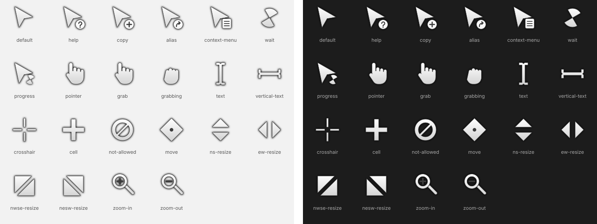

# Neo11 Silber

Weiß-silbernes Icon-Theme für KDE Plasma 6, passend zum Startmenü [Neo11Menu](https://github.com/RembrandtZ4/Neo11Menu).

- Eigene Symbole im einheitlichen Silberstil für die installierten Programme, für Ordner, Laufwerke und die häufigsten Dateitypen
- Die Motive füllen etwa 90 % der Fläche und lassen etwas Luft – so wirken sie in der Taskleiste so zierlich wie unter Windows 11
- Alle übrigen Symbole (Schaltflächen, Systemabschnitt, seltene Dateitypen …) kommen automatisch von Breeze Dark – das Installskript sorgt dafür, dass KDE sie nicht versehentlich durch Silber-Symbole ersetzt
- Markenprogramme (Browser, Steam, Mail …) bekommen bewusst eigene, neutrale Symbole statt ihrer Logos


## Installation

```bash
git clone https://github.com/RembrandtZ4/Neo11-Icons.git
cd Neo11-Icons
./install.sh
```

Danach: **Systemeinstellungen ▸ Farben & Design ▸ Symbole ▸ „Neo11 Silber“**.

## Symbolgröße ändern

```bash
./install.sh 75     # Motive füllen 75 % der Fläche (Standard: 90)
```

Die gewählte Größe wird gemerkt – ein späteres `./install.sh` ohne Zahl behält sie bei. Die endgültige Größe in der Taskleiste hängt außerdem von der Leistenhöhe ab.

## Neue Symbole hinzufügen

Alle Motive und Zuordnungen stehen in `tools/generate.py` (`GLYPHS` sowie `APPS`, `PLACES_EXTRA`, `DEVICES`, `MIMETYPES`). Nach einer Änderung:

```bash
python3 tools/generate.py
./install.sh
```

## Mauszeiger „Neo11 Zeiger“

Passende Mauszeiger im gleichen Stil: weiße, leicht silberne Formen mit weichem Schatten, 22 Zeiger (inkl. animiertem Warten-Kreis) in den Größen 24 bis 96 px.



```bash
./install-zeiger.sh
```

Danach: **Systemeinstellungen ▸ Farben & Design ▸ Mauszeiger ▸ „Neo11 Zeiger“**.
Die Zeiger werden mit `python3 zeiger/tools/generate_cursors.py` aus den Motiven im Skript erzeugt (benötigt `rsvg-convert`).

## Entfernen

```bash
rm -rf ~/.local/share/icons/Neo11-Silber ~/.local/share/icons/Neo11-Zeiger
```
