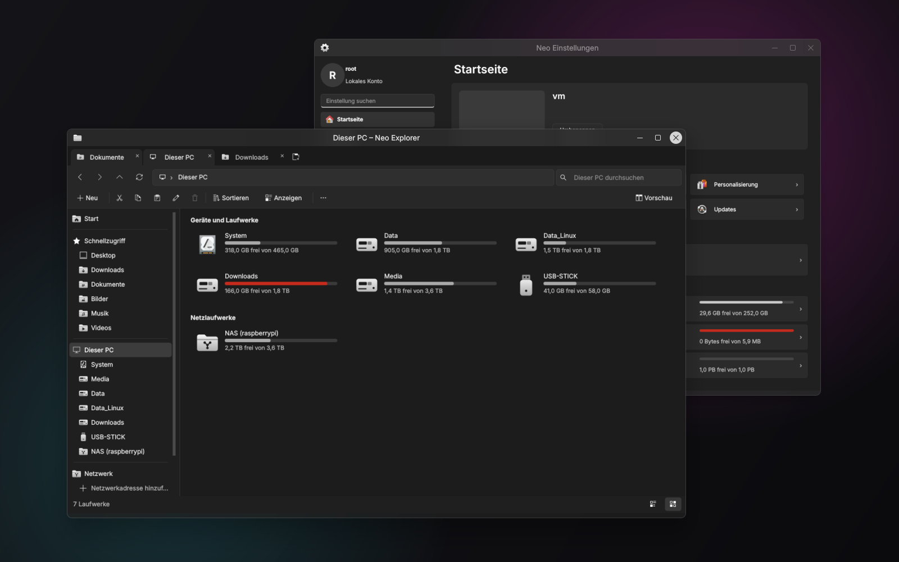
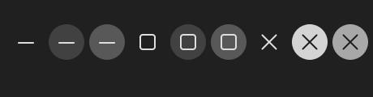

# Neo11 Silver

A white and silver icon theme for KDE Plasma 6, matching the start menu [Neo11Menu](https://github.com/RembrandtZ4/Neo11Menu) – plus cursors, a Plasma style, a color scheme and a window decoration for the complete Neo11 look.

- Own icons in a consistent silver style for installed apps, folders, drives and the most common file types
- The glyphs fill about 90 % of the area and leave some room – so they look as delicate in the taskbar as on Windows 11
- All other icons (buttons, system sections, rare file types …) come from Breeze Dark automatically – the install script makes sure KDE doesn't replace them with silver icons by mistake
- Branded apps (browser, Steam, mail …) deliberately get their own neutral icons instead of their logos


## Install

```bash
git clone https://github.com/RembrandtZ4/Neo11-Icons.git
cd Neo11-Icons
./install.sh
```

Then: **System Settings ▸ Colors & Themes ▸ Icons ▸ “Neo11 Silber”**.

## Change the icon size

```bash
./install.sh 75     # glyphs fill 75 % of the area (default: 90)
```

The chosen size is remembered – a later `./install.sh` without a number keeps it.

## Add new icons

All glyphs and mappings are in `tools/generate.py` (`GLYPHS` plus `APPS`, `PLACES_EXTRA`, `DEVICES`, `MIMETYPES`). After a change:

```bash
python3 tools/generate.py
./install.sh
```

## Cursors “Neo11 Zeiger”

Matching cursors in the same style: white, slightly silver shapes with a soft shadow, 22 cursors (incl. an animated busy circle) in sizes from 24 to 96 px.


```bash
./install-zeiger.sh
```

Then: **System Settings ▸ Colors & Themes ▸ Cursors ▸ “Neo11 Zeiger”**. The cursors are generated with `python3 zeiger/tools/generate_cursors.py` (needs `rsvg-convert`).

## Plasma style and color scheme “Neo11”

Dark Plasma style based on Fluent-round-dark with a **silver accent** instead of blue and readable tooltips (origin: `plasma/HERKUNFT.md`).

```bash
./install-plasma.sh --aktivieren
```

Without `--aktivieren` it is only installed; then pick “Neo11” under **Colors & Themes ▸ Plasma Style** and **▸ Colors**.

## Window decoration “Neo11”

Opaque title bar with round buttons based on Fluent-round-dark – the close button lights up **silver** instead of red on hover, matching the Neo11 accent. Buttons like Windows 11: app icon on the left, minimize, maximize and close on the right. Enabled together with `--aktivieren`, or on its own with:

```bash
./install-plasma.sh --fenster
```

Or: **System Settings ▸ Colors & Themes ▸ Window Decorations ▸ “Neo11”**.





## Taskbar like Windows 11

```
./install-plasma.sh --taskleiste-win11
```

Sets the panel to 48 px – the buttons are then 40 × 40 px. Plasma restarts briefly. For freely adjustable icon size and spacing, use the [Neo11 Taskbar](https://github.com/RembrandtZ4/Neo11-Taskbar).

## Remove

```bash
rm -rf ~/.local/share/icons/Neo11-Silber ~/.local/share/icons/Neo11-Zeiger ~/.icons/Neo11-Zeiger
rm -rf ~/.local/share/plasma/desktoptheme/Neo11 ~/.local/share/color-schemes/Neo11.colors
rm -rf ~/.local/share/aurorae/themes/Neo11
```

---

# Neo11 Silber (Deutsch)

Weiß-silbernes Icon-Theme für KDE Plasma 6, passend zum Startmenü [Neo11Menu](https://github.com/RembrandtZ4/Neo11Menu).

- Eigene Symbole im einheitlichen Silberstil für die installierten Programme, für Ordner, Laufwerke und die häufigsten Dateitypen
- Die Motive füllen etwa 90 % der Fläche und lassen etwas Luft – so wirken sie in der Taskleiste so zierlich wie unter Windows 11
- Alle übrigen Symbole (Schaltflächen, Systemabschnitt, seltene Dateitypen …) kommen automatisch von Breeze Dark – das Installskript sorgt dafür, dass KDE sie nicht versehentlich durch Silber-Symbole ersetzt
- Markenprogramme (Browser, Steam, Mail …) bekommen bewusst eigene, neutrale Symbole statt ihrer Logos


## Installation

```bash
git clone https://github.com/RembrandtZ4/Neo11-Icons.git
cd Neo11-Icons
./install.sh
```

Danach: **Systemeinstellungen ▸ Farben & Design ▸ Symbole ▸ „Neo11 Silber“**.

## Symbolgröße ändern

```bash
./install.sh 75     # Motive füllen 75 % der Fläche (Standard: 90)
```

Die gewählte Größe wird gemerkt – ein späteres `./install.sh` ohne Zahl behält sie bei. Die endgültige Größe in der Taskleiste hängt außerdem von der Leistenhöhe ab.

## Neue Symbole hinzufügen

Alle Motive und Zuordnungen stehen in `tools/generate.py` (`GLYPHS` sowie `APPS`, `PLACES_EXTRA`, `DEVICES`, `MIMETYPES`). Nach einer Änderung:

```bash
python3 tools/generate.py
./install.sh
```

## Mauszeiger „Neo11 Zeiger“

Passende Mauszeiger im gleichen Stil: weiße, leicht silberne Formen mit weichem Schatten, 22 Zeiger (inkl. animiertem Warten-Kreis) in den Größen 24 bis 96 px.


```bash
./install-zeiger.sh
```

Danach: **Systemeinstellungen ▸ Farben & Design ▸ Mauszeiger ▸ „Neo11 Zeiger“**.
Die Zeiger werden mit `python3 zeiger/tools/generate_cursors.py` aus den Motiven im Skript erzeugt (benötigt `rsvg-convert`).

## Plasma-Stil und Farbschema „Neo11“

Dunkler Plasma-Stil auf Basis von Fluent-round-dark mit **silbernem Akzent** statt Blau und lesbaren Infofenstern (Herkunft siehe `plasma/HERKUNFT.md`).

```bash
./install-plasma.sh --aktivieren
```

Ohne `--aktivieren` wird nur installiert; dann in den Systemeinstellungen unter **Farben & Design ▸ Plasma-Stil** und **▸ Farben** jeweils „Neo11“ wählen.

## Fensterdekoration „Neo11“

Undurchsichtige Titelleiste mit runden Knöpfen auf Basis von Fluent-round-dark – der Schließen-Knopf leuchtet beim Drüberfahren **silbern** statt rot, passend zum Neo11-Akzent. Wird bei `--aktivieren` mit eingeschaltet, einzeln mit:

```bash
./install-plasma.sh --fenster
```

Oder: **Systemeinstellungen ▸ Farben & Design ▸ Fensterdekorationen ▸ „Neo11“**.


## Taskleiste wie Windows 11

Tipp: Mit der [Neo11 Taskleiste](https://github.com/RembrandtZ4/Neo11-Taskbar) lassen sich Symbolgröße, Knopfgröße und Abstände frei einstellen – unabhängig von der Leistenhöhe.

```
./install-plasma.sh --taskleiste-win11
```

Stellt die Leiste auf 48 px Höhe – die Knöpfe sind dann 40 × 40 px groß. Plasma startet danach kurz neu.

Kleinere Symbole in der Taskleiste: `./install.sh 75` (siehe „Symbolgröße ändern“) – Plasma 6 erlaubt keine eigene Symbolgröße nur für die Taskleiste.

## Entfernen

```bash
rm -rf ~/.local/share/icons/Neo11-Silber ~/.local/share/icons/Neo11-Zeiger ~/.icons/Neo11-Zeiger
rm -rf ~/.local/share/plasma/desktoptheme/Neo11 ~/.local/share/color-schemes/Neo11.colors
rm -rf ~/.local/share/aurorae/themes/Neo11
```
