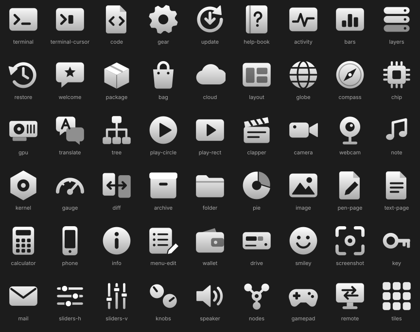

# Neo11 Silber

Weiß-silbernes Icon-Theme für KDE Plasma 6, passend zum Startmenü [Neo11Menu](https://github.com/RembrandtZ4/Neo11Menu).

- Eigene Symbole im einheitlichen Silberstil für die installierten Programme
- Die Motive füllen etwa 90 % der Fläche und lassen etwas Luft – so wirken sie in der Taskleiste so zierlich wie unter Windows 11
- Alle übrigen Symbole (Ordner, Dateitypen, Schaltflächen …) kommen automatisch von Breeze Dark
- Markenprogramme (Browser, Steam, Mail …) bekommen bewusst eigene, neutrale Symbole statt ihrer Logos




## Installation

```bash
git clone https://github.com/RembrandtZ4/Neo11-Icons.git
cd Neo11-Icons
./install.sh
```

Danach: **Systemeinstellungen ▸ Farben & Design ▸ Symbole ▸ „Neo11 Silber“**.

## Symbolgröße ändern

```bash
./install.sh 80     # Motive füllen 80 % der Fläche (Standard: 90)
```

Die endgültige Größe in der Taskleiste stellst du außerdem über die Leistenhöhe ein.

## Neue Symbole hinzufügen

Alle Motive und die Zuordnung „Programm → Motiv“ stehen in `tools/generate.py` (`GLYPHS` und `APPS`). Nach einer Änderung:

```bash
python3 tools/generate.py
./install.sh
```

## Entfernen

```bash
rm -rf ~/.local/share/icons/Neo11-Silber
```
